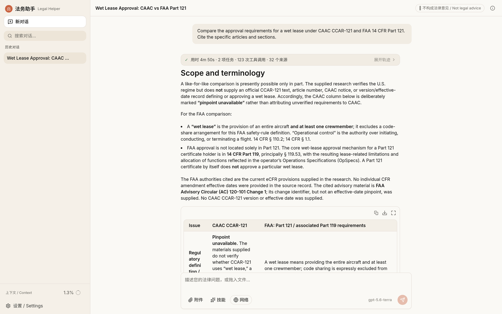
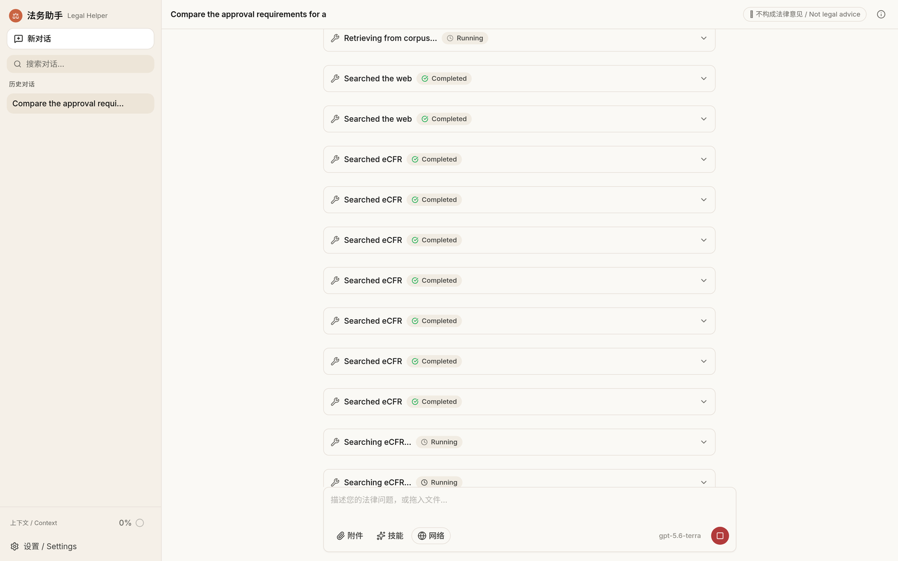
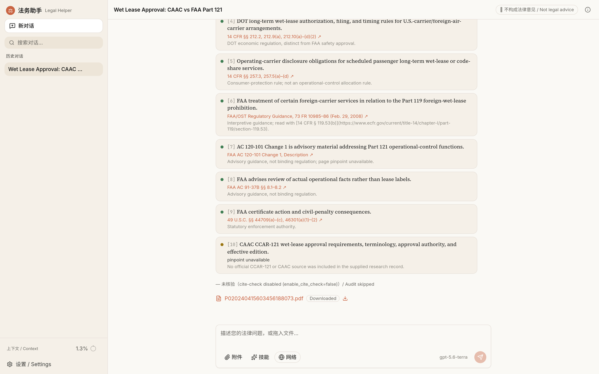
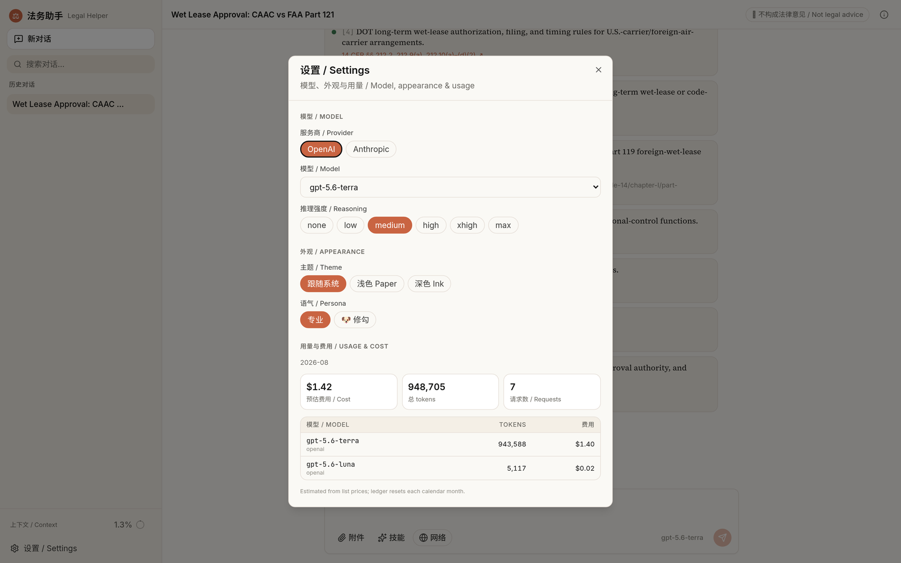
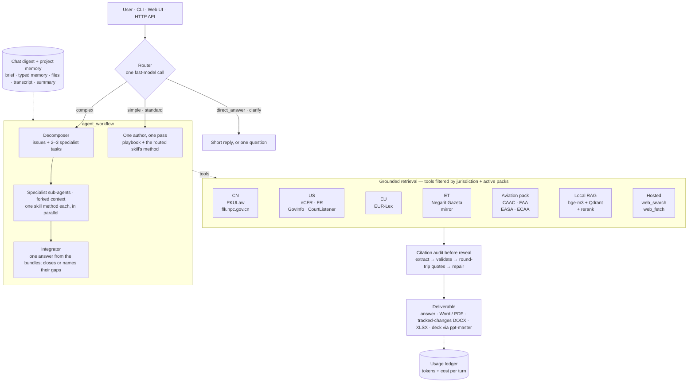

<div align="center">

# ⚖️ Lawgent

**An open-source legal AI agent — grounded, multi-jurisdiction, citation-verified.**

Answers most requests in one research pass and splits a complex matter across parallel
specialist sub-agents. Pulls primary law from official sources, round-trips every quotation
against the document it came from, and returns a memo, tracked-changes redline, workbook, or
deck.

<br/>


-F59E0B)


</div>

> [!NOTE]
> **Who it is for.** A practising lawyer — a solo practitioner, an in-house team of one, or
> anyone who has to be right about the law in more than one country — who wants the grind
> taken out of research and citation. Prior work it builds on is credited in
> [acknowledgements](#acknowledgements); [current limitations](#status-and-known-gaps) are
> listed in full.

> [!IMPORTANT]
> **Not legal advice.** This harness assists with legal workflows. Every output must be
> reviewed by qualified counsel before it is relied on for advice, filings, negotiations,
> or operations. Citation verification is a safety net, not a substitute for a lawyer.

---

## Table of contents

- [What it is](#what-it-is)
- [What it looks like](#what-it-looks-like)
- [Architecture](#architecture)
- [Quickstart](#quickstart)
- [Multi-nation: one harness, many legal systems](#multi-nation-one-harness-many-legal-systems)
- [Multi-area: skills and domain packs](#multi-area-skills-and-domain-packs)
- [External procedural skills](#external-procedural-skills)
- [The tool surface](#the-tool-surface)
- [The grounding stack](#the-grounding-stack)
- [Runtime internals](#runtime-internals)
- [Web UI and HTTP API](#web-ui-and-http-api)
- [Configuration](#configuration)
- [Repository layout](#repository-layout)
- [Testing](#testing)
- [Status and known gaps](#status-and-known-gaps)
- [Acknowledgements](#acknowledgements)

---

## What it is

Most "legal AI" is a chat box in front of a general model: it answers fluently, invents
article numbers, and knows one legal system. This repository is the other thing — the
**harness** around the model that makes legal output checkable. Three commitments shape it:

**1. Primary sources, not recollection.** Statutes, regulations, and judgments are fetched
live from the databases that publish them — 国家法律法规数据库, PKULaw, eCFR, the Federal
Register, GovInfo, CourtListener, EUR-Lex, ECAA — or read from a locally ingested corpus
(the CAAC rules, ICAO documents). Where no connector exists, the official gazette, regulator
or court site is searched. The rule is to cite only what was read.

**2. Every claim carries a pinpoint, and pinpoints are audited, not trusted.** Answers end
with one `## Sources` / `## 资料来源` list, one line per source with its 条款 / article /
section / § and a status: verified online, unverified, user-provided, or pinpoint
unavailable (无法获得具体条款). Before the answer is shown, a citation audit re-fetches the
cited documents and round-trips the quoted language against them; a citation that does not
survive is repaired or flagged, never quietly kept. The audit needs `enable_cite_check`, off
in the shipped `config.yaml` for fast iteration; turn it on for matter work.

**3. Jurisdiction is a first-class axis.** The connectors an agent can see and the source
hierarchy it follows change with the jurisdiction; the answer's language follows the user's.
PRC law is the default frame: the playbook ranks legislation in 立法法 order, weight-labels
every case and cites the version in force on the date of the facts
([details](#multi-nation-one-harness-many-legal-systems)). US and EU are first-class
comparative systems; ET has its own law connectors, and ICAO ships with the aviation pack.

Around them sit durable project memory for matters that outlive a chat and a per-turn cost
ledger. The document layer reads what a practice receives (legacy Word and WPS files,
tracked changes, scanned PDFs, OFD), writes Chinese Word and PDF to PRC conventions (A4,
第 X 页 共 Y 页, the GB/T 9704 公文 layout on request), marks up contracts as real Word
tracked changes, and hands every deck to ppt-master.

---

## What it looks like

Real runs against live sources, captured from the web UI. (In-product branding is
**法务助手 / Legal Helper** — Lawgent is the project name.)

**The answer.** A comparative CN/US question; the chip above it reports elapsed time,
specialist tasks, tool calls and distinct sources. In the CAAC column the table says
*pinpoint unavailable* rather than invent an article number, because no official CCAR-121
text made it into the record.



**Tool use, live.** Every connector call — eCFR, GovInfo, PKULaw, the local corpus, hosted
web search — appears as its own card with running / completed / error state, so the reviewer
sees the whole retrieval.



**Sources with pinpoints.** Each authority carries its pinpoint
(`14 CFR §§ 212.2, 212.9(a)`, `49 U.S.C. §§ 44709(a)–(c)`) or, like entry [10], says
*pinpoint unavailable*. The line under the list notes the audit was skipped:
`enable_cite_check` was off. The capture predates the one-line-per-source format.



**Settings and the cost ledger.** Switch provider, model, reasoning effort or answer length
mid-matter; month-to-date tokens and cost are broken out per model.



---

## Architecture



**One fast-model routing call sizes each turn.** Simple and standard turns go to
**one author** that researches and writes in a single pass with the general playbook and the
routed skill's method, or a general prompt for non-legal work. Only a complex turn — several
issues that each need sustained research in their own body of law — pays for a decomposer,
two or three forked-context specialists researching in parallel, and an integrator that
writes the one answer from their bundles.

With `enable_cite_check` on, a legal answer is audited, and repaired where it fails,
before it is revealed ([the grounding stack](#the-grounding-stack)). Both providers see
**the same tool surface**: connectors, MCP-discovered tools, RAG, citation tools and
document writers are all plain function tools, with no provider-native MCP path and no
Claude-only or GPT-only branch. Detail: [runtime internals](#runtime-internals).

---

## Quickstart

```bash
# 1. Environment (Python and Node in one conda env)
conda create -n llm python=3.11 && conda activate llm
pip install -r requirements.txt
npm install                    # web UI + mermaid-cli
npm run build                  # the React UI that `serve` hosts
conda install -n llm graphviz  # `dot` draws diagram pictures; `serve` warns if absent
# Optional: LibreOffice (`soffice` on PATH) for Office previews, .doc/.rtf/.odt/.wps and
# compare_docx; ppt-master for decks (see External procedural skills).

# 2. Keys — at least one provider key
cp .env.example .env           # ANTHROPIC_API_KEY / OPENAI_API_KEY / PKULAW_API_TOKEN / …

# 3. Ask it something
python -m legal_helper run --task "Review this NDA for PRC-law exposure" \
    --input examples/general/sample_commercial_nda.md

# 4. Or use it interactively
python -m legal_helper chat                # streaming REPL
python -m legal_helper serve --port 8010   # FastAPI + React UI
```

Switch jurisdiction, pack or provider per invocation:

```bash
python -m legal_helper run --jurisdiction US --task "Does 14 CFR 121 permit this wet lease?"
python -m legal_helper run --domain-pack aviation \
    --task "Review this dry-lease against the playbook" \
    --input examples/aviation/sample_aircraft_lease.md
MODEL_PROVIDER=openai python -m legal_helper chat   # or anthropic; nothing else changes
```

### API keys and what unlocks what

| Variable | Unlocks | Required? |
|---|---|---|
| `ANTHROPIC_API_KEY` · `OPENAI_API_KEY` | Claude or GPT provider, with its hosted web search and fetch | at least one |
| `PKULAW_API_TOKEN` | The nine PKULaw MCP sub-services (primary PRC lookup) | optional — falls back to flk.npc.gov.cn: a statute's status and versions, not its text |
| `GOVINFO_API_KEY` | GovInfo, directly and through GPO's GovInfo MCP | optional — the GovInfo tools fail without it |
| `COURTLISTENER_API_TOKEN` | Higher CourtListener rate limits | optional |
| `COURTLISTENER_MCP_TOKEN` | CourtListener's official MCP server (`verify_citations`), a secondary US path; an OAuth bearer, not the REST token | optional |

Keys come from the environment or from `.env` / `legal_helper/api_key`, both gitignored.

---

## Multi-nation: one harness, many legal systems

Jurisdiction is a runtime filter, not a prompt hint. `filter_for(jurisdictions, packs)` in
`legal_helper/connectors/__init__.py` decides which connectors an agent can see, and the MCP
registry is filtered the same way. The set is the run's default plus its secondary
(comparative) jurisdictions — from `config.yaml`, a project or `--jurisdiction` — and, for a
specialist, those an active pack declares. Without CN, PKULaw and flk.npc.gov.cn stay
hidden.

| Jurisdiction | Primary-source stack | Tools the agent gets |
|---|---|---|
| 🇨🇳 **CN** (default) | PKULaw (statutes, 司法案例, 检察文书, 律所文章), 国家法律法规数据库 | `pkulaw_*` (9 MCP sub-services), `flk_npc_search/fetch`; aviation pack: `caac_local_search/fetch` |
| 🇺🇸 **US** | eCFR, Federal Register, GovInfo, CourtListener | `ecfr_search/fetch`, `federal_register_search/fetch`, `govinfo_search/fetch`, `courtlistener_search/fetch`; aviation pack: `faa_title14_search`, `drs_search` |
| 🇪🇺 **EU** | EUR-Lex (CELEX + SPARQL), EASA | `eurlex_search/fetch`; aviation pack: `easa_ad_search/fetch`, `easa_ear_index` |
| 🇪🇹 **ET** | Federal Negarit Gazeta mirror, ECAA | `ethiopia_law_search/fetch`; aviation pack: `ecaa_index/fetch` |
| ✈️ **ICAO** | Chicago Convention + annexes, ICAO docs, Cape Town / IDERA | local RAG collections `icao_doc`, `aviation_treaties` |
| 🇬🇧 **UK** / 🇭🇰 **HK** | No dedicated connector yet; hosted web search + fetch | `web_search`, `web_fetch`, `fetch_url_to_artifact` |

**Comparative work is the normal case.** A short comparison is answered by one author
holding every configured jurisdiction's connectors; a market-entry memo, whose issues each
need their own body of law, goes to specialists ([architecture](#architecture)). Either way
every paragraph says whose law it applies, and comparative law contextualises, never
overrides.

Across jurisdictions:

- **Source hierarchy** — §0 of `legal_helper/playbook/general_playbook.md`, inlined for every
  legal author and specialist: legislation ranked as the 立法法 sets it; a 司法解释 cited
  after the statute it applies; 规范性文件 and 会议纪要 as reasoning, never 裁判依据; cases
  weight-labelled (指导性案例 应当参照, 人民法院案例库参考案例 参考); each conflict of norms
  resolved by a named rule; a treaty only through its domestic hook; the 涉外 choice-of-law
  steps; the version in force on the operative date.
- **Language** — the answer follows the request's script (a message too short to tell follows
  the user's last substantive one, then `default_language`); primary sources are quoted in
  the original, translated when the languages differ.
- **Citation style** — `citation_style` in `config.yaml`: `gb_t_7714` (PRC default),
  `bluebook` (US) or `oscola` (UK / EU); a setting, not inferred from the jurisdiction.

---

## Multi-area: skills and domain packs

### 15 practice skills

Each skill is a progressive-disclosure bundle. Its `SKILL.md` (under 100 lines) is the
method: the planner picks the skill for each piece of legal work, and that file is inlined,
with the general playbook, for whoever does it — the author, or each specialist on a complex
turn. `references/` prose and `resources/` presets stay on disk until that agent calls
`read_skill_reference`.

| Skill | What it does |
|---|---|
| `review-contract` | Clause-by-clause review against a configurable playbook: deviations, business impact, redlines |
| `triage-nda` | Fast NDA classification — GREEN (sign) / YELLOW (counsel) / RED (full review) |
| `draft-agreement` | Bilingual PRC-first agreements and litigation documents from deal terms |
| `docx-redline` | Native Word tracked changes and margin comments (`redline_docx`); two drafts into a 比对稿 blackline (`compare_docx`) |
| `compliance-check` | Statutes, approvals, filings and reporting duties for a proposed action, product or data flow |
| `legal-risk-assessment` | Severity × likelihood matrix with escalation triggers |
| `litigation-analysis` | 案情分析 / 争议焦点归纳: an issue tree; claims and defences mapped element by element to facts, evidence and authority, in lifecycle order (产生 → 未消灭 → 可行使 → 抗辩); 类案 search to the SPC 2020 checklist; eight cause-of-action presets; limitation by `compute_period` |
| `legal-response` | Structured replies to regulators, enforcement letters and counterparty demands |
| `meeting-briefing` | Negotiation and authority-meeting preparation packs |
| `brief` | Daily scan, topic research or incident briefing |
| `vendor-check` | Third-party diligence — standing, sanctions screening, certificates, ESG |
| `signature-request` | Multi-party closing and execution packages with a signature matrix |
| `tabular-review` | Document grids — one row per document, one column per question, pinpoint cite in every cell |
| `cite-check` | Round-trips every citation and quotation against its primary source |
| `flowchart` | Process maps, decision trees, swimlanes, 结构图 and 思维导图 — on a slide via `create_deck`, or as a picture via `render_flowchart_image` |

### Domain packs

A **domain pack** adds subject-matter depth to the generic skills without forking them. It
is active when `active_domain_packs`, a project or `--domain-pack` names it, or when its
markers appear in the request or the last three messages. Then its playbook and source
routing are standing context for every legal author and specialist, and the skill in use
gets its overlay; otherwise no generic prompt or `SKILL.md` names its regulators, treaties or
tools, and two tests keep it that way.

```
legal_helper/domains/aviation/
├── pack.yaml               # CN · US · EU · ET · ICAO, trigger markers, overlay map
├── playbook.md             # domain defaults under general playbook §0
├── research_sources.md     # which tool reaches FAA, EASA, CAAC, ICAO and ECAA law
├── references/ethiopia.md
└── overlays/               # 13 per-skill deltas
    ├── review-contract.md  # → lease/purchase clause taxonomy, Cape Town, IDERA
    ├── compliance-check.md # → FAA / EASA / CAAC approvals, filings, reporting windows
    └── …
```

**Aviation** is the populated pack today: CAAC / MOT / FAA / EASA / ICAO, Cape Town and
IDERA, sales and leasing, charter and wet-lease, MRO / Part-145, hull and liability
insurance, accident investigation, ITAR / EAR, CORSIA. It takes rank from the general
playbook, so ICAO SARPs reach an operator only through national rules, net of filed
differences. It picks articles by event date: the 2025 民用航空法 revision, in force from
2026-07-01, moved the treaty-priority clause from 第184条 to 第260条.

A new pack (say, employment) is a directory with the same pieces, discovered on the next
process start. No core code changes unless it brings its own source: a connector in
`legal_helper/connectors/` or an MCP server in `.mcp.json`, gated to the pack by a
`domain_packs` field.

---

## External procedural skills

The fifteen in-tree skills are legal methodology, inlined into the prompt with the playbook. A
second kind lives outside the package and is driven, not inlined: it carries its own workflow,
reference tree, artifact contracts and gate scripts.

[ppt-master](https://github.com/hugohe3/ppt-master) makes every deck Lawgent produces. It
authors one SVG per page, compiles them to native DrawingML, and gates the result with its own
quality checker. Lawgent drives the official distribution unmodified through one tool,
`create_deck`:

```bash
# the skill is the repo's skills/ppt-master folder; keep .git for updates and link it in
git clone https://github.com/hugohe3/ppt-master ~/src/ppt-master
ln -s ~/src/ppt-master/skills/ppt-master ~/.claude/skills/ppt-master   # scanned by default
grep -v '^google-genai' ~/.claude/skills/ppt-master/requirements.txt > /tmp/ppt-reqs.txt  # drop google-genai (Gemini images only): it can upgrade pydantic and websockets
pip install -r /tmp/ppt-reqs.txt                                        # its scripts run under this Python
python ~/.claude/skills/ppt-master/scripts/attribution_guard.py         # exit 0 = intact

python -m legal_helper chat
# > 做一份关于个人信息出境合规的管理层汇报 PPT
```

`create_deck` hands ppt-master a self-contained brief (the sub-agent never sees the chat) and
keeps the project under the chat's `_decks/` folder, out of the file list. It then opens,
counts and lints the export and reads ppt-master's own postflight before it reports the deck. A
user's own .pptx or .potx, passed as `template_path`, is the design the deck follows or the
template it fills. Progress streams as `deck_progress` events. Without ppt-master it says so;
there is no fallback deck writer.

Any other installed procedure is driven the same way, through `run_procedure`.
[gongwen-gbt9704-skill](https://github.com/mizzlelover/gongwen-gbt9704-skill) is the case it
was built for: `write_docx(layout="gbt9704")` gives a 公文 its GB/T 9704 page, fonts and
headings itself, but a 正式发文 with its red-head 版头, 发文字号 and 版记 is the skill's work.
Its repository root is the skill, and its scripts are Node:

```bash
git clone https://github.com/mizzlelover/gongwen-gbt9704-skill ~/src/gongwen-gbt9704-skill
ln -s ~/src/gongwen-gbt9704-skill ~/.claude/skills/gongwen   # the link name is the procedure's name
```

A procedure's sub-agent also works from a brief, in a fresh folder under the chat's
`_procedures/`. Only documents reach the chat: the ones its report lists under
`## Deliverables`, or failing that the ones it made. None lands over an existing file, and each
is linted. The installed procedures are an enum in the tool's schema, so the model never
guesses a name, and the author is offered the tool only while one is installed.

Discovery scans `skill_roots()`. **This package is always first and cannot be configured
away**, so a mistyped root can never remove the legal skills. `LEGAL_HELPER_SKILL_ROOTS`
replaces the *external* roots only (default `~/.claude/skills`), and an earlier root shadows a
later one, so a third party cannot silently replace a methodology. Discovered directories are
resolved: a skill linked in from a clone can run its own scripts, while a script linked out of
it is refused.

Three tools make driving possible. `write_text_file` writes only under `outputs/` (during a
deck or procedure run, only in that run's folder), never in the project root, which holds the
source tree. `run_skill_script` runs a `.py` under the harness's own Python or a
`.mjs`/`.js`/`.cjs` under Node, from an argv list with no shell, and only a script that
resolves *inside* a discovered skill's directory. `list_skill_dir` lists a skill's tree, so
reference paths are read, not guessed. A non-zero exit is returned as data, because that is
how a skill's gates reach the model.

An external skill gets a **host runtime contract** instead of legal methodology: its resolved
`SKILL_DIR` (read-only for the run), the call mapping and its limits, and the two assumptions
that fail here. There is no interactive channel, so blocking user gates run under the skill's
own explicit-delegation provision, and each decision is reported under
`## Decisions under delegation`, which `create_deck` and `run_procedure` return with their
result. There are no background processes, so a preview server is never started. Its loop has
no round limit (`external_skill_max_iterations`, default 0 = unlimited): a capped loop never
reaches the export step.

> **Trust boundary.** A script under a configured root runs with the harness's privileges —
> that is what "drive this skill" means. Roots are operator-configured; never point one at a
> directory the model can write to, or `write_text_file` and `run_skill_script` compose into
> arbitrary code execution.

---

## The tool surface

78 in-process function tools (55 harness tools and 23 primary-source connectors), plus the
tools of the HTTP MCP servers (the nine PKULaw services, and CourtListener's and GovInfo's
official servers) and the hosted web search / fetch pair. They are assembled per turn from who
is calling (author, specialist or procedure sub-agent), the active skill, jurisdictions and
packs, so provider tool schemas stay small. The workflow executor runs the plan's tasks, and no
plan task runs a procedure: `create_deck` and `run_procedure` are the only tools that start a
sub-agent.

<details open>
<summary><b>Legal research and retrieval</b></summary>

| Tool | Purpose |
|---|---|
| `legal_source_search` | One entry point over eCFR, Federal Register, GovInfo, CourtListener, EUR-Lex and 国家法律法规数据库, chosen by `source` |
| `ecfr_search` · `ecfr_fetch` | US Code of Federal Regulations, current and historical |
| `federal_register_search` · `federal_register_fetch` | Rules, proposed rules, notices |
| `govinfo_search` · `govinfo_fetch` | US Code, CFR, bills, committee and CRS material |
| `courtlistener_search` · `courtlistener_fetch` | US case law and dockets |
| `eurlex_search` · `eurlex_fetch` | EU law by CELEX / title / SPARQL |
| `flk_npc_search` · `flk_npc_fetch` | 国家法律法规数据库 (free PRC fallback) |
| `pkulaw_*` (9 MCP services) | PRC statutes by 条号, semantic statute and case search, 案号 recognition, 法条 traceback, citation validation, doc linking, NL search |
| `ethiopia_law_search/fetch` · `ecaa_index/fetch` | Ethiopian proclamations and ECAA regulations |
| `aviation_source_search` · `faa_title14_search` · `drs_search` · `easa_ad_*` · `easa_ear_index` · `caac_local_*` | Aviation regulators (pack-gated); `aviation_source_search` is one entry point over CAAC, FAA DRS, EASA and Ethiopian sources |
| `retrieve_legal` | Local RAG over ingested corpora |
| `web_search` · `web_fetch` · `fetch_url_to_artifact` | Hosted search, hosted fetch, and pinned-to-disk fetch |

</details>

<details open>
<summary><b>Citations, grounding, and QC</b></summary>

| Tool | Purpose |
|---|---|
| `extract_citations_tool` | eyecite (US) + PRC regex (案号, 法释, 国函, 国办发, 部令, 《…》第X条) |
| `validate_citations_tool` | Structural checks per jurisdiction (US reporters against reporters-db): `verified`, `flagged` or `could_not_check` |
| `quote_roundtrip_tool` | Does the quoted language actually appear in the source? |
| `ground_answer_tool` | Find cites → fetch each source → round-trip every quote → grounding score |
| `provenance_audit_tool` | Flags citations with no provenance tag (`[PKULaw]`, `[model knowledge — verify]`, `[settled — last confirmed YYYY-MM-DD]`); an untagged cite counts as model knowledge |
| `cite_check_report_tool` | Reviewer-facing verdict table |
| `verification_log_append_tool` | Append-only audit trail of what was checked, when, against what |
| `compute_period` | Deadlines (期间计算) under 民事诉讼法 第八十五条 or 民法典 第二百零一条至第二百零四条, on the official 调休 calendar, with each step's legal basis, or as plain calendar arithmetic for foreign and contractual periods (`rule="calendar"`); days to years, not hours |

</details>

<details open>
<summary><b>Documents in, documents out</b></summary>

| Family | Tools |
|---|---|
| Read / inspect | `read_document` (Word incl. .doc/.rtf/.odt/.wps, spreadsheets incl. .xls/.et, presentations incl. .ppt, PDF, OFD, EPUB, images, .zip; scans OCR'd), `inspect_docx`, `inspect_pdf`, `inspect_xlsx`, `inspect_xlsx_range`, `inspect_pptx`, `extract_pdf_tables`, `extract_clauses` (clauses, with the paragraph index `redline_docx` takes) |
| Write | `write_docx` / `write_pdf` (A4 + 第 X 页 共 Y 页 in Chinese, Letter + Page X of Y in English, or the GB/T 9704 公文 layout; firm templates via `write_docx`'s `reference_docx`; the AI notice in the file's properties, or omitted, with a stated reason, from filings and anything to be signed), `write_xlsx` (formulas saved with their computed values, ISO dates as real dates, number formats, columns sized for their text, Chinese included), `create_deck` (every presentation or 汇报材料, through ppt-master), `run_procedure` (any other installed procedure, e.g. a red-head 公文) |
| Edit an existing file | `edit_docx_text`, `edit_xlsx_cells`, `edit_xlsx_cells_checked` (guarded, with protected ranges), `edit_pptx_text`, `copy_xlsx_sheet`, `reshape_docx/xlsx/pptx`. None overwrites its source; a Word edit reports what it lost and refuses a paragraph with tracked changes; a workbook edit is recalculated and reports any formula left in error, and its row and column inserts and deletes update formulas, merges and validations as Excel does |
| Prove the edit | `diff_xlsx`, `render_docx_pages`, `render_xlsx_pages`, `render_pptx_slides`, `render_pdf_pages`, `view_image`; renders reach the model as images |
| PDF surgery | `merge_pdfs`, `split_pdf`, `rotate_pdf_pages` |
| Diagrams | `render_flowchart_image` (a Mermaid diagram as a picture, for a document or the chat); a slide's diagram is drawn by ppt-master |
| Redlining | `redline_docx` (real `w:ins` / `w:del` tracked changes and comments, anchored by text, clause label or paragraph; per-category authors; a change it cannot place comes back under `not_found`), `compare_docx` (two drafts into one 比对稿 through LibreOffice, Han text compared character by character; accept-all must give the revised text, reject-all the original) |

</details>

<details open>
<summary><b>Skill runtime and memory</b></summary>

| Tool | Purpose |
|---|---|
| `write_text_file` | Author a text file (SVG, Markdown, JSON) under `outputs/` |
| `run_skill_script` | Run a skill's own Python or Node script: its gates and exporters |
| `list_skill_dir` | List a skill's own tree |
| `list_skill_references` · `read_skill_reference` | A skill's `references/` prose and `resources/` presets, on demand |
| `project_memory_write` · `project_memory_search` · `project_brief_read` | Durable cross-chat matter memory |
| `list_format_recipes` · `read_format_recipe` | House formatting rules for deliverables |

</details>

---

## The grounding stack

Citation discipline is layered; each check catches one failure mode.

| Layer | Failure it catches | Implementation |
|---|---|---|
| **Extraction** | — | `eyecite` + `reporters-db` for US; regex for PRC 案号 / 法释 / statute pinpoints; EU CELEX |
| **Structural validation** | Malformed or impossible citations | `citations/validate.py`, per-jurisdiction |
| **Existence check** | Cites to documents that do not exist | Connector / PKULaw round-trip; PRC cites stay `could_not_check` until a real lookup promotes them to `verified` |
| **Quote round-trip** | Real source, invented quotation | `citations/grounding.py` fetches the source; `citations/groundedness.py` matches the quoted language |
| **Support check** | Real source, real quote, wrong proposition | `cite-check` Mode 2 — does the passage support the cited claim? |
| **Provenance tags** | Model recall presented as retrieval | `citations/provenance.py` — retrieval tags vs. verify tags |
| **Pinpoint rule** | "See the Company Law" with no article | `answer_contract.py`: every sources line has a pinpoint or says `无法获得具体条款` / `pinpoint unavailable`; a repair may not keep an unconfirmed one |

Citation QC is not a task the planner schedules. Once an answer with legal substance is
written, a `cite-check` sub-agent audits it on a tool surface that cannot edit what it
audits: at `filed` stakes (strictest, with a DO-NOT-FILE threshold) when the answer points at
a filing or the turn was routed to `legal-response` / `litigation-analysis`, otherwise at
`internal` stakes.

**The audit runs before you read the answer, and it repairs.** A substantive legal answer is
buffered, audited, and only then revealed, so a citation that does not support its claim is
fixed rather than labelled. A failed audit gets a bounded repair pass (`max_repair_rounds`,
default 1) that must fix exactly the critical and major findings: re-verify with the tools,
correct the pinpoint if the source supports the claim, change or drop the claim if it does
not, never invent a replacement citation. Progress and tool calls still stream live.
`verify_before_reveal: false` restores stream-then-label.

Audit and repair are gated by `enable_cite_check`, `false` in the shipped `config.yaml` for
fast iteration: answers then stream unaudited with an "Audit skipped" note. Turn it on for
matter work.

---

## Runtime internals

**Planner and complexity dial.** One fast-tier routing call classifies each turn `simple` /
`standard` / `complex`, reading the summary and the newest turns first, so the latest turn is
never the one dropped. A greeting or a question about the assistant gets a direct reply
unless the reply states law, which goes to the author. A missing fact gets one clarifying
question, only when the answer can neither proceed on a stated assumption nor briefly cover
each reading. Simple and standard turns, a short comparison or a request for a short answer
included, are answered in one pass. A `complex` turn (several issues, each needing sustained
research in its own body of law) pays for a decomposition call that returns the issues (争点,
claim basis, elements, facts needed and assumed) and two or three specialists with disjoint
evidence surfaces. If planning fails, the turn is answered in one pass, never on a guessed
decomposition.

**One author holds the method.** The single-pass author and the integrator work from one
system prompt (`authoring.py`): research rules, the whole general playbook, the output
contract and, when the router chose a skill, that skill's `SKILL.md`. It is static per mode,
skill and active packs, so it caches; the date, answer language, length tier, points to cover
and any conflicting facts travel in the request tail.

**Sub-agent runtime.** A specialist runs in a forked context with its `SKILL.md` and the
playbook inlined, the chat digest as its cache prefix, and only the attachments its task
names (all of them when no task names any). It returns a research bundle (findings with
pinpoints, per-issue element work, artefacts, out-of-scope items, sources) with a typed
outcome: completed, empty, truncated, refused or failed. The integrator is an author, not a
dispatcher: with the author's tools it walks the plan's issues, reconciles conflicting
findings or says how they sit together, and closes or discloses every gap, including a
failed or empty specialist.

**Roles are a table.** `config.DEFAULT_ROLE_PROFILES` sets the model tier and effort of the
router, decomposer, author, specialists, integrator, cite-check, summariser, title and deck;
`role_profiles:` in `config.yaml` overrides a row. Routing and decomposition run on the fast
tier at low effort, the author at the chat's own setting, specialists and the integrator
capped at medium, and the citation audit on the fast tier at the chat's effort.

**One output contract.** What an answer must look like is rendered from `answer_contract.py`; a
test fails when a prompt restates it. The author leads with the conclusion, cites at the point
of use and, when the facts call for action (a deadline, a filing, evidence to obtain), ends the
analysis with those steps in order. Sources are one numbered line each with a status word in
the answer's language (已在线核验 / 未核验 / 用户提供 / 无法获得具体条款, or verified online / unverified /
user-provided / pinpoint unavailable); no claim column, and no disclaimer line, since the
interface and every export carry one. Length is a tier, not a cap: simple → brief, standard →
focused, complex → full memo, pinnable per chat (`answer_length`). It adds one sentence to the
request and sets OpenAI's `text.verbosity`, never a token, round or tool-budget limit; a length
the user asks for wins.

**The answer lint is a stream filter** (`answer_lint.py`). Working on whole lines as the
answer streams, so a URL is never split, it strips `utm_*` parameters, drops a search chip
repeated within a paragraph, turns links to uploads and generated files into served routes,
renders a link with no real address as its label, localises `pinpoint unavailable` in a
Chinese answer, and rewrites each sources line as `N. [name](url) — status`. It logs its
changes, never grades style and never calls a model.

**Deliverables are measured before they are handed over**: write, measure, look, repair,
re-measure, the deterministic layer first because it costs nothing.

1. **Conformance** (`documents/quality.py`). On a slide, groups included: shapes off the
   canvas, overlap past 2% of the smaller shape, text that cannot fit its box (CJK-aware,
   using the frame's real insets), table rows that grow past the slide, runs under the 11pt
   body / 9pt label floor, WCAG contrast, empty placeholders. In Word, PDF and Excel: list
   numbering that runs on across a heading, Markdown residue (`**`, `####`, `|---|`, `[^1]`),
   a table split across pages without a repeating header row, XLSX error values, formulas
   with no cached value, a number wider than its column (Excel's `###`). A type with no
   checks reports "no checks for this type", never "pass". Each finding names its location. A
   check belongs here only when a pass means "nothing is provably broken"; occupancy measures
   were removed after they ranked an empty generated slide above a dense statutory one.
2. **The pages, as pixels.** Rendering a file the model wrote returns a contact sheet, the
   lint findings and a next step as one image result, so the model sees pages, not a path; a
   file it is only reading is marked so, and it is not told to repair it. Where a preview
   cannot be trusted the result says so: GB or Office fonts drawn by named stand-ins, or a
   positioned table LibreOffice does not draw, such as a 公文's 版记 (see
   [known gaps](#status-and-known-gaps)).

`write_docx` / `write_pdf` also return the lint when their file fails it, and a workbook edit
reports numbers that no longer fit their column. Whether to look is the model's call; no
repair loop is enforced. Decks are the exception: ppt-master's own quality gate stops a
failing export (see [external procedural skills](#external-procedural-skills)).

**Diagrams.** On a slide, ppt-master draws them as editable shapes. Elsewhere,
`render_flowchart_image` has Graphviz draw a Mermaid flowchart or mind map in a CJK face,
without a browser; other Mermaid types go to mermaid-cli, nested containers to `d2`.

**Provider parity.** One `Provider` protocol over Anthropic (`claude-opus-5-5`; fast tier
`claude-sonnet-5`) and OpenAI (`gpt-6.1-sol`; fast tier `gpt-6-luna`) covers streaming, tool
calls, reasoning traces, prompt caching and hosted web search; `tests/test_provider_parity.py`
runs one workflow turn through a mock of each and checks they return the same result shape.
Anthropic caches the tool list and system prompt for an hour, with an automatic breakpoint
inside tool loops; OpenAI sends a system prompt long enough to cache as a developer message
with an explicit breakpoint.

**Calls that can overlap, do.** When one response asks for several lookups, both providers
run the ones declared safe side by side (`providers/tool_exec.py`): every connector, the
read-only PKULaw, CourtListener and GovInfo MCP services, document reads and inspections.
Overlap is declared per tool in `tool_policy.py`, never inferred: page renders change nothing
but share PDFium, which is not thread-safe, so they queue, and an undeclared call runs alone,
in its place; results return in the order asked. A remote MCP gateway that fails twice
running is skipped for ten minutes, and the model is told to use another source; one success
closes the breaker.

**The user is released at `done`.** The stream closes when the answer is complete; the
rolling summary and chat title follow on a per-chat worker, one job at a time, in order.

**Two kinds of memory.** `context.py` keeps a *single long chat* inside the window with a
CJK-aware token estimator and budgeted recent-message selection. `projects.py` keeps *many
chats* on one matter coherent: a hand-authored brief re-injected every turn, append-only
typed memory (fact / decision / task / open_question / glossary / artifact / risk / source)
ranked by salience, a rolling summary, and compaction. Chat and project summaries both move
by **delta, not rewrite**, since re-summarizing a summary erodes detail every pass (*context
collapse*): the fast model returns only `+ Section | …` / `- Section | …` lines against fixed
sections, a deterministic merge applies them, a bullet leaves only when the model removes it
or its section hits its cap, and a delta that will not parse leaves the summary untouched.

**Compaction is tier-aware, and priced.** Frontier models fold older turns into the summary
at 75% of the input window, the fast tier at 55%, since cheaper models do better summarizing
early. The input window is the window minus the output ceiling, and on OpenAI the trigger is
also capped below the 272K long-context pricing cliff. The decision uses the provider's
reported input for the turn's last request (system prompt, tool schemas and tool results
included), falling back to the local estimate only before any usage arrives.
`chat_compaction_threshold` pins the window share, never the cliff.

**Tool results have a budget** (`tool_budget.py`), per tool and in tokens, not bytes: 50 KB
is ~12K tokens of English but ~50K of Chinese. An over-budget result is truncated with the
loss stated, or spilled to `state/tool_results/` with a path to page through with
`read_document(path=…, offset=…, limit=…)`. Results carrying inline images, and results that
*are* the deliverable (a cite-check report, a grounding verdict), are never cut. Neither a
turn's total tool output nor its rounds are capped: when a long loop nears the turn's input
ceiling, the oldest tool results are cleared (`turn_compaction.py`) without loss. On OpenAI
each is saved first and replaced by a stub naming the file. On Anthropic, where editing an
earlier result would invalidate later thinking, the server clears them
(`clear_tool_uses_20250919`), and each sizeable result is saved and named in a note that
clearing leaves in place.

**Runs are durable** (`runs.py`). Each run writes its phases to
`state/runs/<run_id>/artifacts/` as they complete (plan, research bundles, draft, audits,
repairs), with a snapshot and an event log. A cancel or provider outage finishes the run as
`paused`; passing its `run_id` back as `resume_run_id` reuses the completed bundles instead
of re-running the research. `GET /api/runs` lists what is resumable. Writes are best-effort:
durability can never fail a turn.

**Documents are read as the user sees them.** One reader (`documents/intake.py`) serves
`read_document` and attachments. Word files (.docx, and .doc, .rtf, .odt or .wps through a
cached LibreOffice conversion) read as Word shows them: tracked changes as `{++…++}` /
`{--…--}` under a one-line summary, and a manual strikethrough as `~~…~~`, so a counterparty's
markup never reads as agreed text; headers, footers, footnotes and comments kept; clause
numbers as Word displays them (第一条, not 第1条). PDFs carry `[page N]` markers and take `pages=`;
image-only pages are OCR'd with RapidOCR, cached and labelled, and a read under 200 characters
says so. OFD, China's fixed-layout format, is read in-tree; a .zip lists its members and reads
one by `member=`; an unknown binary is an error, never garbage. One clause index
(`documents/clauses.py`) serves outlines, `read_document(section=…)`, `extract_clauses` and
`redline_docx` anchors, so 第三条, 第3条 and "3" find the same clause. No edit overwrites its
source, and a lineage ledger warns when an edit starts from a superseded version.

**Attachments: inline what fits, outline the rest.** Attached documents are inlined while
their extracted text fits 40% of the turn's input ceiling, counted in tokens. The rest, a
single huge document included, becomes an outline of headings and 第X条 / Article N / clause
labels plus the `read_document(…, section=…)` call that opens it.
`LEGAL_HELPER_INLINE_ATTACHMENT_TOKENS` sets the budget; `0` inlines everything.

**Local RAG.** bge-m3 embeddings and an embedded Qdrant under `state/qdrant/`, with a
legal-aware chunker that respects 第X条 / Article X / § X / clause-numbering boundaries.
Retrieval is hybrid dense + sparse with RRF fusion, over-retrieves 3–4×, then re-ranks with a
local cross-encoder. Nothing in the retrieval hot path leaves the machine.

```bash
python -m legal_helper.rag.ingest --collection general --seed
python -m legal_helper.rag.ingest --collection aviation --seed
python -m legal_helper.rag.ingest --collection user --path ~/my_legal_docs/
```

**Cost ledger** (`usage.py`). Every provider turn, streamed or not, appends token usage to
`state/usage/usage-YYYY-MM.jsonl`, priced per provider: Anthropic bills cache reads and
writes as separate buckets; OpenAI's cached tokens are a discounted subset of input, and a
request over 272K input tokens bills at 2× input / 1.5× output in full. That surcharge is
modelled; `long_context_requests` in the month summary counts it. Recording never breaks a
turn.

**Trajectory failure profile.** Every workflow failure or degradation event carries a
subclass in one of two layers, *substantive* (the law is wrong) or *procedural* (the agent
misbehaved). `citations/trajectory.py` aggregates them per run and flags a clean answer
reached through a broken chain.

**Observability.** JSONL event and turn records under `logs/` capture provider, model,
messages, tool calls, usage, latency and the parent/sub `run_id` tree — enough to replay why
an answer said what it said.

---

## Web UI and HTTP API

`python -m legal_helper serve --port 8010` starts FastAPI with SSE streaming and serves the
React 19 + Vite UI that `npm run build` writes to `legal_helper/webui_dist/`; without a
build it falls back to a minimal legacy page. `npm run dev` adds hot reload on port 5174,
proxying `/api` to 8010.

- **Live trajectory** — plan, per-agent tasks, tool calls and reasoning as they happen, folded
  into a one-line run summary when done; a status line keeps moving through long document
  writes, hosted searches and deck runs
- **Sources** — one line per source, linked where a URL exists, with a status dot: green for
  verified online, amber for unverified or pinpoint unavailable, neutral for the user's own
  files
- **Citation audit card** — progress while the audit runs, then its verdict (pass, needs
  review, DO-NOT-FILE) or why it was skipped
- **Artifacts** — generated DOCX / PDF / XLSX / PPTX on the message that produced them;
  review renders and a deck's or procedure's working files are left out
- **Export** — any answer to DOCX or PDF, with the not-legal-advice notice in the file's
  properties; a DO-NOT-FILE answer gets a draft watermark
- **Settings** — provider, model, reasoning effort and answer length
- **Cost center** — month-to-date tokens and spend by model, earlier months selectable; a
  sidebar ring shows how full the context window is
- **Uploads** — Word (.doc and WPS too), spreadsheets, presentations, PDFs and scans, OFD,
  images (HEIC phone photos too) or a .zip

The not-legal-advice notice sits in the header and under the composer.

Selected endpoints:

```
POST /api/chats
GET  /api/chats/{id}
POST /api/chats/{id}/messages/stream
GET  /api/chats/{id}/runs/{run_id}/stream
POST /api/chats/{id}/runs/{run_id}/cancel
POST /api/chats/{id}/messages/{message_id}/export
POST /api/chats/{id}/upload
GET  /api/chats/{id}/uploads/{upload_id}/{filename}
GET  /api/chats/{id}/artifacts/{artifact_id}
POST /api/chats/{id}/project
GET  /api/projects
POST /api/projects/{id}/memory
POST /api/projects/{id}/compact
GET  /api/runs
GET  /api/runs/{run_id}
GET  /api/usage
GET  /api/runtime-options
GET  /api/skills
GET  /domains
GET  /jurisdictions
```

Projects (memory for a matter that spans chats) are reached through `/api/projects` and
`python -m legal_helper project`; the web UI has no project panel.

---

## Configuration

`config.yaml` holds runtime defaults; `.env` and the process environment override it.

```yaml
provider: openai                  # anthropic | openai

default_jurisdiction: CN          # CN | US | EU | UK | HK | ET | ICAO
secondary_jurisdictions: [US, EU] # comparative systems
default_language: zh              # fallback; answers follow the user's language
citation_style: gb_t_7714         # gb_t_7714 | bluebook | oscola
active_domain_packs: []           # e.g. [aviation]

anthropic_model: claude-opus-5-5
anthropic_fast_model: claude-sonnet-5
openai_model: gpt-6.1-sol         # a named variant; there is no bare "gpt-6.1"
openai_fast_model: gpt-6-luna
openai_reasoning_effort: medium   # none … max; both providers read it
parent_max_iterations: 0          # author and integrator tool-loop round limit; 0 = none
sub_agent_max_iterations: 0       # same, for specialists and the citation audit
external_skill_max_iterations: 0  # same, for external procedures
max_concurrent_agents: auto       # Anthropic 2, OpenAI 4; an integer pins it
max_tokens: 32000                 # per-turn output ceiling
chat_context_token_budget: 16000  # floor of the chat digest's budget
chat_compaction_threshold: 0.0    # 0 = derive from the model tier; any positive value pins it

enable_web_search: true
enable_web_fetch: true
enable_cite_check: false          # the citation audit; off as shipped
verify_before_reveal: true        # audit (and repair) before the answer is shown
max_repair_rounds: 1              # repair passes after a failed audit; 0 = advisory

answer_length: auto               # auto | brief | focused | full
# role_profiles:                  # per-role tier and effort; list only what changes
#   cite_check: {tier: main}      # e.g. audit on the main model, not the fast tier
```

Set `enable_cite_check: true` (or `LEGAL_HELPER_ENABLE_CITE_CHECK=1`) for matter work; with it
off, answers stream unaudited ([the grounding stack](#the-grounding-stack)).
`role_profiles` overrides rows of `config.DEFAULT_ROLE_PROFILES`
([runtime internals](#runtime-internals)); the author and deck rows default to the chat's own
model and effort, which `run_procedure` always uses; the summariser and title rows change only
effort, since both always run on the fast tier. An effort is a level, `user` (the
chat's setting) or `cap:<level>` (that, but no higher).

Environment-only switches include:

| Variable | Default | Effect |
|---|---|---|
| `LEGAL_HELPER_MCP_ENV` | `llm` | conda env searched for bare stdio MCP commands |
| `LEGAL_HELPER_INLINE_ATTACHMENT_TOKENS` | 40% of the turn ceiling | attachment tokens inlined before the rest are outlined; `0` inlines all |
| `LEGAL_HELPER_ANTHROPIC_CLEAR_TOOLS` | on | Anthropic server-side clearing of old tool results; `0`/`off` disables, a number sets the trigger |
| `LEGAL_HELPER_SKILL_ROOTS` | `~/.claude/skills` | external skill roots, `os.pathsep`-separated; in-tree skills always come first |
| `LEGAL_HELPER_NODE` | beside Python, then `PATH` | the Node for mermaid-cli and skills' JS scripts |
| `LEGAL_HELPER_UNO_PYTHON` | detected | a Python that can `import uno`, for `compare_docx` |
| `LEGAL_HELPER_PRICING_JSON` | built-in table | ledger price overrides, shaped like `usage.DEFAULT_PRICING` |
| `LEGAL_HELPER_RAG_RERANK` | `1` | `0` turns off the local cross-encoder rerank |

`.mcp.json` is the MCP registry: the nine PKULaw sub-services (remote HTTP), EUR-Lex (stdio)
and the in-tree `ccar_aviation` server, gated by jurisdiction and active packs. US sources
are direct-API connectors in `legal_helper/connectors/`; nothing to install.

stdio entries name commands bare (`python`, `npx`): `registry.resolve_command()` runs `python`
as the harness's own interpreter and finds the rest on `PATH`, then in the conda bin
directories. A command found nowhere is reported by name instead of failing as an opaque
`CONNECTION_CLOSED`, and `serve` lists any at startup.

---

## Repository layout

The project is **Lawgent**; its Python package is `legal_helper`, the name every import, CLI
invocation and env var uses.

```
legal_helper/
├── workflow.py         # routing, planning, author, specialists, integrator
├── authoring.py        # the author's system prompt
├── answer_contract.py  # the output contract: sources list, status words
├── answer_lint.py      # deterministic answer clean-up as it streams
├── agent.py            # specialist sub-agents; external-skill host contract
├── providers/          # Anthropic + OpenAI behind one protocol
├── server.py           # FastAPI + SSE; chat, project and usage API
├── cli.py              # run · chat · serve · project
├── config.py           # settings, role table, jurisdictions, citation styles
├── context.py          # within-chat token budgets, compaction ceilings
├── attachments.py      # inline what fits, outline the rest
├── tool_budget.py      # per-tool result budgets, spill to file
├── turn_compaction.py  # in-turn clearing of old tool results
├── tool_policy.py      # which tools mutate, are read-only, may overlap
├── runs.py             # durable run record and resume
├── projects.py         # cross-chat brief, typed memory, rolling summary
├── usage.py            # monthly token/cost ledger
├── skills/             # 15 in-tree skills; __init__.py discovers skill_roots()
├── domains/aviation/   # the aviation pack
├── playbook/           # PRC-first defaults + format recipes
├── connectors/         # in-process connectors (CN/US/EU/ET/aviation)
├── mcp/                # MCP registry, manager, adapter, in-tree servers
├── citations/          # extract · validate · round-trip · ground · provenance
├── rag/                # chunker · embeddings · store · hybrid retrieve · rerank
├── documents/          # the deliverable layer
│   ├── intake.py         # one reader for read_document and attachments
│   ├── clauses.py        # one clause index for outlines, reads, redline anchors
│   ├── redline.py        # w:ins / w:del tracked changes and comments
│   ├── compare.py        # two drafts into one tracked-changes DOCX
│   ├── quality.py        # output lint
│   ├── writers/          # DOCX · PDF · XLSX
│   └── …                 # DOCX reader, edit integrity, lineage, PDF ops, diagrams
└── tools/              # function tools, assembled per turn
    ├── decks.py          # create_deck, through ppt-master
    ├── procedures.py     # run_procedure
    ├── redline_tools.py  # redline_docx · compare_docx
    ├── dates.py          # compute_period
    └── skill_runtime.py  # write_text_file · run_skill_script · list_skill_dir

src/                    # React 19 + Vite web UI
tests/
examples/               # fictitious sample contracts and filings
scripts/                # corpus fetchers, expiry flagging, monthly harness review
```

---

## Testing

Always `python -m pytest`: a bare `pytest` resolves against whatever is first on PATH, which
under conda is often an interpreter without the dependencies.

```bash
python -m pytest -q                                 # full suite
python -m pytest -q tests/test_skill_anatomy.py     # SKILL.md ≤ 100 lines, frontmatter, no domain leaks
python -m pytest -q tests/test_provider_parity.py   # one turn, one result shape, both providers
python -m pytest -q tests/test_legal_method_content.py  # PRC doctrine: playbook, pack, presets
python -m pytest -q tests/test_citations.py tests/test_grounding.py  # extract, validate, round-trip
python -m pytest -q tests/test_dates.py             # compute_period: 调休, holidays, month-end
python -m pytest -q tests/test_workflow_planning.py # routing, task merging
python -m pytest -q tests/test_verified_synthesis.py  # audit-then-reveal, repair, clarify gates
python -m pytest -q tests/test_decks.py             # create_deck against a faked ppt-master run
python -m pytest -q tests/test_document_quality.py  # the output lint
python -m pytest -q tests/test_docx_prc_output.py   # A4, 第 X 页 共 Y 页, list restarts, GB/T 9704
python -m pytest -q tests/test_docx_redline.py      # redline_docx: accept/reject round trip

LEGAL_HELPER_LIVE=1 python -m pytest tests/test_integration_live.py -m live                # Anthropic
LEGAL_HELPER_LIVE_OPENAI=1 python -m pytest tests/test_integration_live_openai.py -m live  # OpenAI
```

On a host with every optional tool listed below, the baseline is 946 passed, 3 failed, 2
skipped. The failures are in `tests/test_caac_local_connector.py`: its fixture statutes fall
under the connector's 60-character stub floor and read as PDF-only stubs, and fetching the real
corpus does not change that. The skips are the two opt-in live tests. Anything else is a
regression.

Tests that need what a host may lack — LibreOffice, poppler's `pdftoppm`, Node, Graphviz `dot`,
RapidOCR, the Noto CJK font, pillow-heif (deliberately not in `requirements.txt`), an installed
gongwen — skip without it rather than fail.

---

## Status and known gaps

Current limitations, in full:

- **Aviation is the only populated domain pack.** The pack mechanism is general; the content
  is not yet.
- **UK and HK have no dedicated connectors.** They run on hosted web search plus grounding.
- **PKULaw is not on the single-pass author's surface yet.** The author and the integrator hold
  no MCP tools, so a simple or standard turn looks PRC law up through flk.npc.gov.cn and hosted
  web search; a complex turn's specialists and the citation audit hold PKULaw.
- **Three aviation connector tools are disabled** — `ccar_search`/`ccar_fetch` (the CAAC search
  endpoint moved behind a JS-rendered form) and `drs_fetch` (drs.faa.gov is SPA-only);
  `connectors/__init__.py` gives the reason and the workaround for each.
- **PRC citations stay `could_not_check` until a live PKULaw round-trip.** That is deliberate:
  structural plausibility is not verification.
- **Corpus binaries are not committed.** `legal_helper/rag/corpus/*/manifest.yaml` and the
  fetch scripts are; `scripts/fetch_aviation_corpus.sh` pulls the PDFs on demand.
- **Mermaid types other than flowcharts and mind maps need Chrome**, for
  `@mermaid-js/mermaid-cli`.
- **Decks need ppt-master installed** at a skill root; without it `create_deck` reports
  `unavailable`.
- **The red-head 公文 needs gongwen-gbt9704-skill installed** at a skill root.
  `write_docx` / `write_pdf` with `layout="gbt9704"` set the GB/T 9704 page, fonts and "— n —"
  page numbers but draw no 版头, 发文字号 or 版记; those come through `run_procedure`.
- **Several document tools need LibreOffice** (`soffice`): reading `.doc` / `.rtf` / `.odt` /
  `.wps`, the Office previews, stored formula values and `compare_docx` (which also needs a
  Python that can `import uno`). Without it a legacy Word file goes through a plain converter
  with a note on what may be missing, the `formulas` engine computes formulas, and the
  previews and `compare_docx` return an error.
- **Legacy formats are read, not edited.** The Office inspect, edit, render and redline tools
  take only .docx, .xlsx and .pptx: a .doc, .wps, .rtf, .odt, .xls, .et or .ppt can be read
  (and a Word one compared with `compare_docx`) but must be saved in the modern format before
  it is edited or marked up.
- **Office previews are LibreOffice renders.** LibreOffice 7.3 does not draw a table floated
  against the page or margin (`w:tblpPr`), such as a 公文's 版记, though Word and WPS do; and no
  GB font is bundled, so a host without 仿宋, 黑体, 楷体 or 小标宋 draws stand-ins of other widths.
  `render_docx_pages` reports both (`floating_tables_not_rendered`, `font_stand_ins`), so
  neither is "fixed" in a file that was never broken.
- **`compute_period` knows 调休 only for the years `chinesecalendar` covers.** For other
  years it counts only weekends and fixed-date holidays as rest days and marks the result
  `UNVERIFIED CALENDAR`; the `chinesecalendar` floor in `requirements.txt` needs a bump each
  November.

---

## Acknowledgements

Almost nothing here is a new idea. The legal-skill structure, the citation-verification
discipline, the retrieval stack, and the chat UI all came from other people's work; what
this repo contributes is the assembly, the PRC-first framing, and the connector layer.

### Directly adapted

| Project | License | What this repo took from it |
|---|---|---|
| [anthropics/claude-for-legal](https://github.com/anthropics/claude-for-legal) | Apache-2.0 | The backbone. Provenance-tag taxonomy (`citations/provenance.py`), the groundedness framing (`citations/groundedness.py`), the verification-log format (`citations/log.py`), and the "say so when the source is unavailable" discipline |
| [CSlawyer1985/claude-for-legal-ZH](https://github.com/CSlawyer1985/claude-for-legal-ZH) | Apache-2.0 | 《Claude for Legal — 中国法版本》: the reference for carrying those skills into 中国法 practice — PRC source hierarchy and 法条 pinpointing. The issue/element method's issue tree, three search rounds and 类案 matrix follow ideas in its `issue-memo` and `case-comparison`, restated in our own words |
| [sboghossian/master-claude-for-legal](https://github.com/sboghossian/master-claude-for-legal) | see repo | The citation-verifier skill — its two-mode (exists / supports) procedure and report format, extended here with PRC equivalents |
| [anthropics/skills](https://github.com/anthropics/skills) | see repo | The Agent Skills `SKILL.md` format itself (pattern only, no code copied) |
| [anthropics/claude-cookbooks](https://github.com/anthropics/claude-cookbooks) | MIT | Prompting patterns distilled into `skills/flowchart/references/cookbook_patterns.md` |
| [Paper2Poster / PosterAgent](https://github.com/Paper2Poster/Paper2Poster) | MIT | A **closed** critic vocabulary — its Painter↔Commenter loop answers only `overflow` / `too blank` / `good to go` — a principle `documents/quality.py` keeps by reporting check names, not prose |
| [hugohe3/ppt-master](https://github.com/hugohe3/ppt-master) | MIT | **Driven, not adapted.** Every deck is made by the official distribution, unmodified, through `create_deck`; its own `svg_quality_checker.py` gates the export. Not vendored: its `attribution_guard.py` fails closed on any modification ([install](#external-procedural-skills)) |
| [mizzlelover/gongwen-gbt9704-skill](https://github.com/mizzlelover/gongwen-gbt9704-skill) | MIT | **Driven, and the reference for the in-tree 公文 layout.** `run_procedure` drives it for a red-head 公文; `layout="gbt9704"` takes its margins exactly as the skill's verifier (`scripts/verify_gongwen_docx.mjs`) pins them, and its footer distance and heading spacing from the skill's own calibration; a test runs that verifier over the output when the skill and Node are installed |
| [icip-cas/PPTAgent](https://github.com/icip-cas/PPTAgent) | MIT | PPTEval's three axes — content, design, coherence — and the argument that design is scoreable; no in-tree deck judgement uses them any more, since ppt-master's own gate judges each deck |
| [Textual-to-Visual Iterative Self-Verification](https://arxiv.org/abs/2502.15412) | paper | Review a layout as a *picture*, not a coordinate list — why an authored render returns to the model as images |
| [vercel/ai-elements](https://github.com/vercel/ai-elements) + [shadcn/ui](https://github.com/shadcn-ui/ui) | see repos | The chat UI component layer — conversation, message, reasoning, plan, task, tool, sources |
| [lilialla/request-right-skill-reference](https://github.com/lilialla/request-right-skill-reference) | MIT (code) / CC BY 4.0 (method text) | The claim lifecycle — arises → not extinguished → enforceable → defences — as the row order of the issue/element method (`skills/litigation-analysis/references/issue_element_method.md`), restated in our own words |
| [happylawyer/jiubufa-skill](https://github.com/happylawyer/jiubufa-skill) | MIT | The 八个一致 consistency check, the denial-vs-defence split and the 真伪不明 rule in the issue/element method |
| [cat-xierluo/legal-skills](https://github.com/cat-xierluo/legal-skills) (`court-sms`) | MIT | PRC service-of-process and period rules as the reference and test cases for `compute_period` |
| [tats-u/markdown-cjk-friendly](https://github.com/tats-u/markdown-cjk-friendly) | MIT | The CJK-friendly emphasis amendment, reimplemented (not vendored) in the writers' shared Markdown front end (`documents/writers/_markdown.py`), so `**结论：**正文` comes out bold |

### Shaped the design

Surveyed rather than copied, but each changed a decision here:

- [harveyai/harvey-labs](https://github.com/harveyai/harvey-labs) — the Legal Agent Benchmark;
  why grounding is an automated pass, not a prompt instruction
- [lawve-ai/awesome-legal-skills](https://github.com/lawve-ai/awesome-legal-skills) — a curated
  map of the legal Agent Skills ecosystem
- [anylegal-ai/anylegal-oss](https://github.com/anylegal-ai/anylegal-oss) — a multi-LLM harness
  that loads `SKILL.md` unmodified; a check on provider parity
- [Open-Source-Legal/OpenContracts](https://github.com/Open-Source-Legal/OpenContracts) —
  documents as a programmable citation graph
- [iflow-mcp/lawmotion-ai-vibe-lawyering](https://github.com/iflow-mcp/lawmotion-ai-vibe-lawyering)
  — its 北大法宝 MCP notes helped wire PKULaw
- [blevinstein/aviation-mcp](https://github.com/blevinstein/aviation-mcp) — prior art for MCP
  servers over aviation APIs
- [legislation/legislation-mcp-ts](https://github.com/legislation/legislation-mcp-ts) — The
  National Archives' official legislation.gov.uk MCP; where a real UK connector should start
- [BLK-WHT/LEGO](https://github.com/BLK-WHT/LEGO) — doctrine cards consulted as an issue
  checklist for the litigation-analysis element presets; no card text was adopted
- Evaluation work that set the bar:
  [CSHaitao/LegalAgentBench](https://github.com/CSHaitao/LegalAgentBench),
  [SKYLENAGE-AI/PLawBench](https://github.com/SKYLENAGE-AI/PLawBench),
  [XMUDeepLIT/LegalGraphRAG](https://github.com/XMUDeepLIT/LegalGraphRAG), and
  [lexpath-project/LexPath](https://github.com/lexpath-project/LexPath)

### Built on

**Documents** — [LibreOffice](https://www.libreoffice.org/),
[python-docx](https://github.com/python-openxml/python-docx),
[python-pptx](https://github.com/scanny/python-pptx), openpyxl,
[markdown-it-py](https://github.com/executablebooks/markdown-it-py),
[mdit-py-plugins](https://github.com/executablebooks/mdit-py-plugins),
[WeasyPrint](https://github.com/Kozea/WeasyPrint),
[formulas](https://github.com/vinci1it2000/formulas),
[anydoc](https://github.com/firecrawl/anydoc),
[markitdown](https://github.com/microsoft/markitdown), pypdfium2, pypdf,
[pdfplumber](https://github.com/jsvine/pdfplumber),
[RapidOCR](https://github.com/RapidAI/RapidOCR),
[ooxml-integrity](https://pypi.org/project/ooxml-integrity/), pi-heif and
[Pillow](https://github.com/python-pillow/Pillow).

**Diagrams** — [Graphviz](https://graphviz.org/), [D2](https://github.com/terrastruct/d2),
[Mermaid](https://github.com/mermaid-js/mermaid) and
[mermaid-cli](https://github.com/mermaid-js/mermaid-cli).

**Dates** — [chinesecalendar](https://github.com/LKI/chinese-calendar) (法定休假日 and 调休 for
`compute_period`).

**Citations & case law** — [eyecite](https://github.com/freelawproject/eyecite),
[reporters-db](https://github.com/freelawproject/reporters-db), and
[CourtListener](https://www.courtlistener.com/) from the Free Law Project.

**Retrieval** — [Qdrant](https://github.com/qdrant/qdrant), [BAAI
bge-m3](https://huggingface.co/BAAI/bge-m3),
[sentence-transformers](https://github.com/huggingface/sentence-transformers).

**Tool boundary** — the [Model Context Protocol](https://modelcontextprotocol.io/).

**App** — FastAPI, React, Vite, Tailwind, streamdown, lucide.

**Legal data** — PKULaw / 北大法宝, 国家法律法规数据库, eCFR, the Federal Register, GovInfo,
CourtListener, EUR-Lex, EASA, CAAC, ECAA and the Federal Negarit Gazeta. Their terms apply
to anything retrieved through them; see [NOTICE](NOTICE).

If your project belongs here and is missing, that is an oversight, not a judgement — open an
issue and I will add it.

---

<div align="center">

**Lawgent** · MIT licensed · Built for practitioners who have to be right.

*Not legal advice. Have qualified counsel review every output before relying on it.*

</div>
